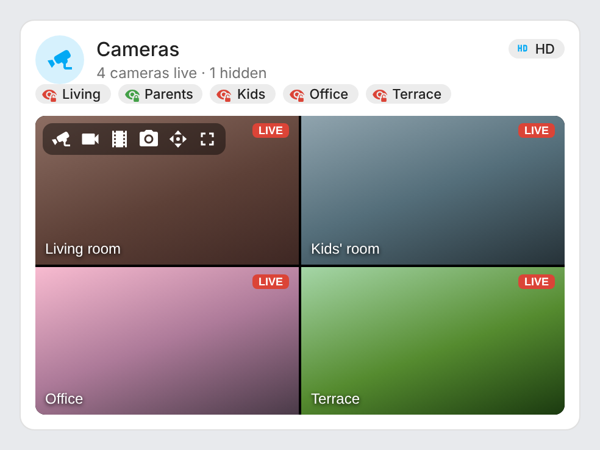
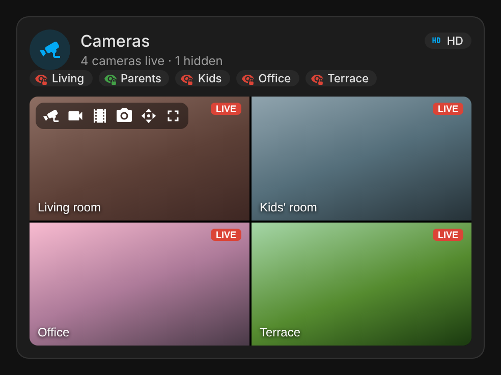

# ha-home-camera-card

[](https://github.com/hacs/integration)
[](https://github.com/juju35/ha-home-camera-card/actions/workflows/hacs.yml)
[](https://github.com/juju35/ha-home-camera-card/actions/workflows/validate.yml)
[](https://github.com/juju35/ha-home-camera-card/releases/latest)
[](LICENSE)

Custom Lovelace card for Home Assistant showing **every home camera in one grid**, with a **privacy badge per camera**, an **HD / SD switch** and **PTZ controls**.

List the cameras, the card finds their privacy switch, SD stream and PTZ buttons by itself.

[](https://my.home-assistant.io/redirect/hacs_repository/?owner=juju35&repository=ha-home-camera-card&category=plugin)

| Light | Dark |
|---|---|
|  |  |

## Features

- Header with the number of cameras live and hidden, and an **HD / SD** badge
- One badge per camera: green lock when the camera is hidden, red when it films; tap to toggle its privacy switch (or its smart plug)
- A single camera: its name is the title, a round *Disable* / *Enable* icon button sits on the right and the HD / SD badge under the title
- Hidden cameras are removed from the grid: a camera is hidden when its **privacy switch is on** or its **power switch is off**
- **HD / SD** switch: from an `input_select` shared by every dashboard, or from the card itself (remembered by the browser)
- Live grid, clips, snapshots, PTZ and fullscreen through [Advanced Camera Card](https://github.com/dermotduffy/advanced-camera-card); any of its options can be set through `camera_card`
- Without Advanced Camera Card, a grid of Home Assistant's own live camera cards
- Automatic discovery on the camera's device: `switch.*_privacy`, `button.*_move_left/right/up/down`, and the `*_sd_stream` camera next to a `*_hd_stream` one (Tapo integration naming)
- Visual editor in the dashboard UI (no YAML needed)
- English and French, follows the Home Assistant language
- Light and dark theme compatible
- HACS-ready, a single file with no dependency

## Prerequisites

- Home Assistant 2024.8 or later with `camera` entities
- [Advanced Camera Card](https://github.com/dermotduffy/advanced-camera-card) (HACS) for the grid with clips, snapshots and PTZ — optional, the card falls back to Home Assistant's camera cards
- Optional: an `input_select` with the options `HD` and `SD` to share the quality between dashboards and devices

## Installation

### Via HACS (recommended)

Click the button below to add the repository directly:

[](https://my.home-assistant.io/redirect/hacs_repository/?owner=juju35&repository=ha-home-camera-card&category=plugin)

Or manually:

1. Open HACS → **Frontend** → **⋮** → **Custom repositories**
2. Add `https://github.com/juju35/ha-home-camera-card` — Category: **Dashboard** (Lovelace)
3. Search for **Home Camera Card** and install it
4. Clear your browser cache and refresh

HACS registers the dashboard resource for you.

### Manual

1. Download `home-camera-card.js` from the [latest release](https://github.com/juju35/ha-home-camera-card/releases/latest)
2. Copy it to `/config/www/`
3. Go to **Settings → Dashboards → Resources** → Add resource:
   - URL: `/local/home-camera-card.js`
   - Type: **JavaScript Module**
4. Clear your browser cache and refresh

## Configuration

### Visual editor

Add the card from the dashboard (**Add card → Home Camera Card**) and add the cameras in the **Cameras** list. Options left at their default are not written to the YAML.

### Minimal

```yaml
type: custom:home-camera-card
cameras:
  - camera.living_room_hd_stream
  - camera.bedroom_hd_stream
```

With the Tapo integration, each camera brings its SD stream, its privacy switch and its PTZ buttons on its own.

### Full options

```yaml
type: custom:home-camera-card
title: Cameras
icon: mdi:cctv
quality_entity: input_select.camera_quality
hd_option: HD
sd_option: SD
columns: 2
cameras:
  - camera: camera.living_room_hd_stream
    name: Living room
    short_name: Living
  - camera: camera.bedroom_parents_hd_stream
    name: Parents' bedroom
    short_name: Parents
    sd: camera.bedroom_parents_sd_stream
    privacy: switch.bedroom_parents_privacy
    ptz: button.bedroom_parents_move
  - camera: camera.terrace
    name: Terrace
    power: switch.terrace_camera_plug
    ptz: false
camera_card:
  menu:
    buttons:
      clips:
        enabled: false
```

### Options reference

| Option | Required | Default | Description |
|---|---|---|---|
| `cameras` | ✅ | — | List of cameras, see below; a bare entity id is a camera with every option found automatically |
| `title` | ❌ | `Cameras` | Card title; with a single camera, its name |
| `icon` | ❌ | `mdi:cctv` | Icon next to the title |
| `quality_entity` | ❌ | — | `input_select` (or `select`) holding the quality; without it the card keeps its own choice in the browser |
| `hd_option` | ❌ | `HD` | Option of `quality_entity` meaning HD |
| `sd_option` | ❌ | `SD` | Option of `quality_entity` meaning SD |
| `columns` | ❌ | `2` | Columns of the grid |
| `show_summary` | ❌ | `true` | Summary line under the title |
| `show_badges` | ❌ | `true` | Privacy badges under the header |
| `camera_card` | ❌ | — | Advanced Camera Card options, merged into the generated configuration (`menu`, `live`, `status_bar`…) |
| `language` | ❌ | Auto | Force language: `fr` or `en` (auto-detects from HA settings) |

**Camera options**

| Option | Description |
|---|---|
| `camera` | Camera entity, shown in HD |
| `name` | Name on the grid; defaults to the entity name |
| `short_name` | Name on the privacy badge; defaults to `name` |
| `sd` | Camera entity shown in SD; defaults to the `*_sd_stream` next to a `*_hd_stream` camera, else the HD one |
| `privacy` | Switch hiding the camera when **on**; defaults to the `switch.*_privacy` of the camera's device, `false` for none |
| `power` | Switch (smart plug) hiding the camera when **off** |
| `ptz` | PTZ buttons: a prefix (`button.x_move` → `button.x_move_left`, `_right`, `_up`, `_down`), an object `{left, right, up, down}`, or `false`; defaults to the `button.*_move_*` of the camera's device |

## Screenshots

| Light | Dark |
|---|---|
|  |  |

## How it works

The card draws its own header and badges, and hands the visible cameras to Advanced Camera Card: its configuration is rebuilt only when the quality or the list of visible cameras changes, so the streams are not reloaded on every state update. When the quality is SD, every camera that has an SD stream uses it.

Discovery looks at the entities of the camera's device in the entity registry. Anything set in the configuration wins over what is found.

## Development

```bash
npm install
npm run build        # stamps the version of package.json into dist/home-camera-card.js
npm run check        # builds and checks the card (run in CI)
npm run screenshots  # renders the card with mock cameras into screenshots/
```

`dist/` is not committed: `npm run build` creates it locally, CI builds it on every push, and the release workflow attaches the built file to the release, which is where HACS downloads it from.

### Releasing

1. Bump `version` in `package.json`
2. Add a `## <version>` section at the top of [CHANGELOG.md](CHANGELOG.md)
3. Push to `main`: the **Release** workflow builds the card, creates the tag and the GitHub release with the changelog section as notes, and attaches `home-camera-card.js`

## Translations

The card auto-detects the language from your Home Assistant settings. Currently supported:

| Language | Code |
|---|---|
| English | `en` |
| Français | `fr` |

Contributions for additional languages are welcome!

## License

[MIT](LICENSE)
